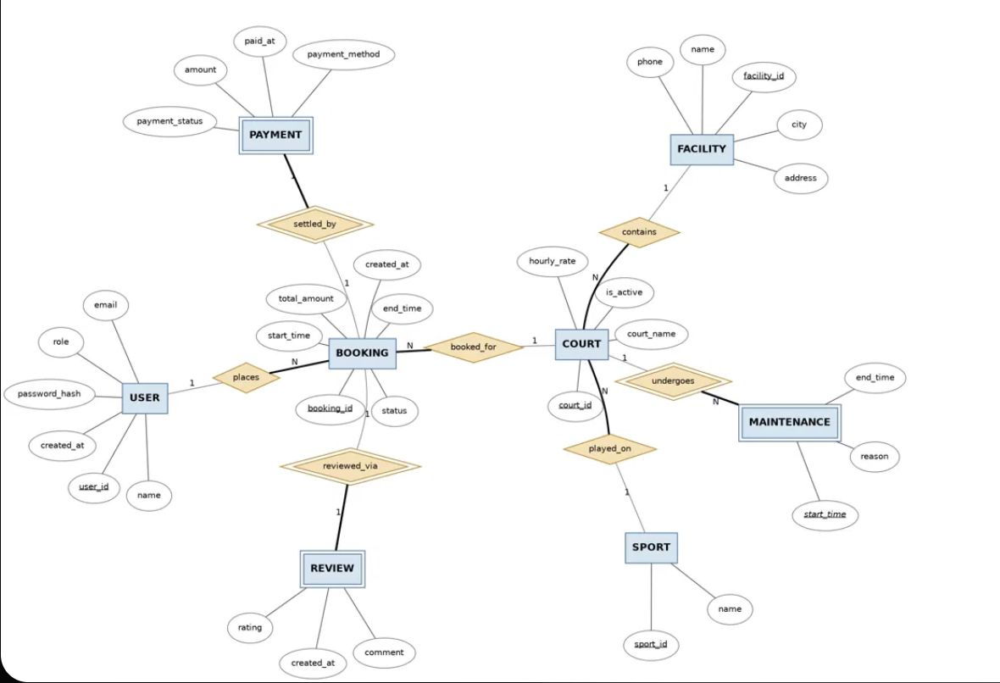

# Smart Sports Management System

A Django + PostgreSQL web application for booking sports courts across multiple facilities, built as a DBMS course project. It covers the full booking flow (facilities → courts → bookings → payments → reviews), an administrator area, and a **DBMS Lab** that runs a catalogue of SQL queries live against the project database.



## Features

**Customers**
- Register / log in with email
- Browse facilities and courts, see availability, book hourly slots
- Pay for, cancel and review bookings

**Administrators** (`/manage/`)
- CRUD for facilities, courts and sports; activate/deactivate courts
- Approve or cancel bookings (individually or in bulk), mark payments received
- Moderate reviews, schedule court maintenance
- Revenue and usage reports

**DBMS Lab** (`/dbms-lab/`)
- Browse every table and view with its columns, keys and constraints
- 50 catalogued queries in 8 sections: Basic SQL, Joins, Aggregation, Advanced queries, Design & integrity, Transactions & concurrency, Performance & query plans, Reports (see [docs/SQL_QUERIES.md](docs/SQL_QUERIES.md))
- A free-form SQL editor that runs as a **SELECT-only PostgreSQL role** inside a read-only transaction with a statement timeout and a row limit
- Sandbox queries that run write statements in a transaction that always rolls back
- `EXPLAIN ANALYZE` comparisons with and without index scans

## Database design highlights

- **Tables:** `users`, `facilities`, `sports`, `courts`, `bookings`, `payments`, `reviews`, `maintenance`
- **Double-booking prevention:** a GiST `EXCLUDE` constraint (via `btree_gist`) on court + time range
- **Triggers:** stop a booking from overlapping court maintenance, and maintenance from overlapping a booking
- **Views:** `v_booking_details`, `v_facility_revenue`
- `CHECK` constraints on roles, statuses, amounts and time ranges

## Tech stack

- Python 3.12+, Django 6.1
- PostgreSQL 14+ (via `psycopg` 3)
- `pglast` for parsing and validating SQL typed into the lab editor

## Getting started

### 1. Clone and install

```bash
git clone https://github.com/Sumukhkalkura/Smart_Sports_Management_System.git
cd Smart_Sports_Management_System
python3 -m venv .venv
source .venv/bin/activate        # Windows: .venv\Scripts\activate
pip install -r requirements.txt
```

### 2. Create the database

```bash
createdb smart_sports
```

### 3. Configure environment

```bash
cp .env.example .env
```

Edit `.env` and set `DJANGO_SECRET_KEY`, `DB_USER` / `DB_PASSWORD` for your PostgreSQL install, and a password for the read-only lab role (`DB_READONLY_PASSWORD`).

### 4. Migrate, create the lab role, seed data

```bash
python manage.py migrate
python manage.py setup_readonly_role
python manage.py seed_data
```

### 5. Run

```bash
python manage.py runserver
```

Open http://127.0.0.1:8000/.

### Demo logins (created by `seed_data`)

| Role | Email | Password |
|------|-------|----------|
| Admin | `admin@sportsms.local` | `Admin@12345` |
| Customer | `aarav.sharma@example.com` | `Player@12345` |

These are for local demos only.

## Management commands

| Command | Purpose |
|---------|---------|
| `seed_data` | Load fixed sample data (only into an empty database) |
| `seed_data --reset` | Truncate the domain tables and seed again (asks first) |
| `seed_data --bulk 20000` | Also add 20,000 historical bookings for `EXPLAIN` demos |
| `setup_readonly_role` | Create or refresh the SELECT-only role used by the lab editor |
| `export_sql_catalogue` | Regenerate `docs/SQL_QUERIES.md` from `dbms_lab/catalogue.py` |

## Running tests

Tests run against a PostgreSQL test database (the custom runner also creates the read-only role inside it):

```bash
python manage.py test
```

## Project structure

```
config/        Django settings, URLs, custom test runner
sports/        Main app: models, booking services, customer and admin views, reports
  migrations/  Schema, plus raw-SQL triggers and views
  management/  seed_data, setup_readonly_role, export_sql_catalogue
  tests/       Constraint, service, schema and view tests
dbms_lab/      SQL catalogue, validator, read-only executor, schema introspection
templates/     HTML templates
static/        CSS
docs/          Generated SQL query catalogue
```
